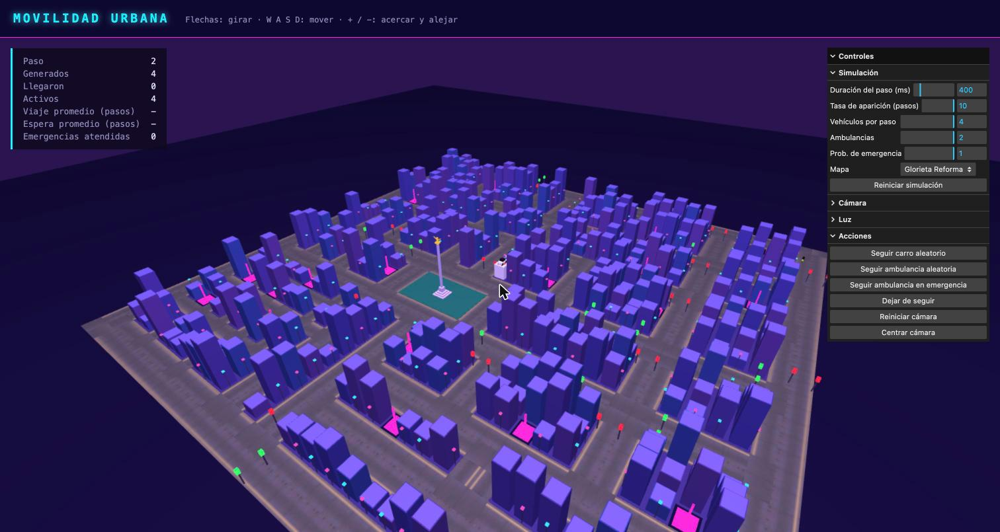

# MA-CG Group 5 - Urban Mobility

Traffic simulation for the course **TC2008B Multi-Agents and Computer Graphics**
(Modelación de sistemas multiagentes con gráficas computacionales).

Every car is an individual agent that crosses the city alongside other autonomous
agents: it follows the street directions, respects the traffic lights and avoids
other cars. The simulation runs in Mesa and is drawn in 3D with WebGL.



Made by

| Name | Student ID |
|------|------------|
| Juan Carlos Luz Gallardo | A01028527 |
| Isabela Valls Chavez | A01173825 |
| Francisco Javier Becerra Gómez | A01027383 |

---

## 📋 Table of Contents

1. [About the Project](#about-the-project)
2. [Repository Structure](#repository-structure)
3. [Prerequisites](#prerequisites)
4. [Installation & Setup](#installation--setup)
5. [Running the Simulation](#running-the-simulation)
6. [Map Legend](#map-legend)
7. [Server API](#server-api)
8. [Agent Design](#agent-design)
9. [References](#references)

---

## About the Project

The challenge is to model urban mobility as a multi-agent system. The project
starts from the course base project
([gilecheverria/TC2008B](https://github.com/gilecheverria/TC2008B), `BaseProject`)
and extends it:

- Cars spawn at the corners of the map and drive to a destination with an A* route.
- Traffic lights in two groups, so crossing streets are never green at the same time.
- Flying ambulances that leave from a hospital, answer emergencies and land on a
  reserved road cell.
- A roundabout (glorieta) around a monument on the `2025_reforma.txt` map.
- A 3D city with buildings, textured streets and street lamps.

## Repository Structure

The repository contains the following material:

- 📂 **Backend** Mesa model and Flask server (port 8585).
    - `city_server.py` the `/init`, `/city` and `/step` endpoints.
    - `traffic_base/agent.py` cars, motorcycles, traffic lights, roads, destinations and obstacles.
    - `traffic_base/ambulance.py` ambulances and emergencies.
    - `traffic_base/model.py` the city model: reads the map, spawns cars, steps the agents.
    - `traffic_base/city_graph.py` the street graph used for A* routes.
    - `city_files/` city maps and `mapDictionary.json`.
    - `tests/` tests for the model and the server.
- 📂 **Frontend** WebGL client using TypeScript and Vite (port 5173).
    - `libs/` 3D math, camera, lights, shapes and the OBJ loader from the course.
    - `src/main.ts` the scene, the drawing loop and the GUI.
    - `src/api_connection.ts` the requests to the server.
    - `src/city.ts` builds the streets, buildings, traffic lights and the hospital.
    - `src/vehicles.ts` places the cars and ambulances between steps.
    - `src/camera.ts` camera controls; `src/hud.ts` the statistics panel; `src/config.ts` settings.
    - `assets/shaders/` Phong shaders; `assets/models/street/` the street model and texture.
- 📂 **docs** description of the data the server sends to the frontend.
- 📄 `docker-compose.yml` starts both servers with Docker.

## Prerequisites

Before setting up the environment, ensure you have the following installed:

- **Python 3.12+**: [Download Python](https://www.python.org/downloads/)
- **Git**: [Download Git](https://git-scm.com/downloads)
- **Node.js 20.19+ or 22.12+**: [Download Node](https://nodejs.org/)

Optional requirements:

- **Docker**: [Docker Desktop](https://www.docker.com/products/docker-desktop/)

## Installation & Setup

We recommend using a Python virtual environment to manage dependencies.

### 1. Clone the Repository

```bash
git clone https://github.com/malikethbbz/MA-CG-Group-5.git
cd MA-CG-Group-5
```

### 2. Create the Virtual Environment

Create a virtual environment named `.agents`:

**Windows / macOS / Linux:**

```bash
python -m venv .agents
```

### 3. Activate the Environment

**Windows (PowerShell):**

```bash
.\.agents\Scripts\Activate
```

**Windows (Command Prompt):**

```bash
.\.agents\Scripts\activate.bat
```

**macOS / Linux:**

```bash
source .agents/bin/activate
```

*You will know the environment is active when you see `(.agents)` at the start of your command line.*

### 4. Install Dependencies

Backend:

```bash
pip install -r Backend/requirements.txt
```

Frontend:

```bash
cd Frontend
npm install
```

## Running the Simulation

Run the backend and the frontend in two terminals.

### Step 1: Start the Python Backend

```bash
cd Backend
python city_server.py
```

The server listens on port 8585 (http://localhost:8585).

### Step 2: Run the WebGL application

```bash
cd Frontend
npx vite
```

Open http://localhost:5173/. To open another map, pick it in the **Mapa** menu (inside **Simulación**)
or add it to the URL, for example http://localhost:5173/?map=2025_reforma.txt.

Controls: arrows rotate the camera, `W` `A` `S` `D` pan, `+` / `-` zoom.

### Docker compose

From the root of the repository:

```bash
docker compose up --build
```

### Tests

```bash
cd Backend
pip install -r requirements-dev.txt
python -m pytest
```

```bash
cd Frontend
npm test
```

## Map Legend

From `Backend/city_files/mapDictionary.json`:

| Symbol | Meaning |
|--------|---------|
| `>` `<` `^` `v` | Road and its direction |
| `S` `s` | Traffic light (green for 15 and 7 steps) |
| `#` | Obstacle / building |
| `D` | Destination |
| `A` | Monument (center of the roundabout) |

The two light groups share a 22-step cycle: `s` lights are green for the first 7 steps,
then `S` lights for the next 15.

## Server API

| Endpoint | Method | Returns |
|----------|--------|---------|
| `/init` | GET, POST | Creates the model. Optional JSON body, see the options below |
| `/city` | GET | Static map: size, roads, obstacles, destinations, lights, hospital, helipads and landmarks |
| `/step` | GET | Advances one step and returns the stats, light colors, vehicles and events |

| `/init` option | Default | Meaning |
|----------------|---------|---------|
| `map` | `"2025_base.txt"` | `2025_base.txt` or `2025_reforma.txt` |
| `seed` | `42` | Random seed |
| `spawnInterval` | `10` | Steps between spawns, 1 to 10 |
| `carsPerSpawn` | `4` | Most cars a spawn step places on the free corners, 1 to 4 |
| `ambulances` | `2` | Number of ambulances, 0 to 2 |
| `emergencyChance` | `1.0` | Chance, 0 to 1, that an emergency opens every 25 steps |

A value that is not a number, out of range, or a map that is not in `city_files`
returns `400`. The full description of each answer is in
[`docs/frame-api.md`](docs/frame-api.md).

Grid `(x, y)` maps to world `(x, z)`; `y` is the height in the 3D scene. Calls made
before `/init` return `409`.

## Agent Design

Every spawn step puts a car (30% of them motorcycles) on each free map corner, up to
`carsPerSpawn`. Each car then runs the first behavior whose condition holds, from
highest to lowest priority:

1. No route available: wait
2. Red light on the next cell: stop
3. Car or ambulance-reserved cell ahead: wait; every 3 blocked steps, look for a route
   around it
4. Otherwise: drive one cell along the A* route

Routes come from a directed street graph built from the map. A move is legal when it
never goes against the direction of the current or the next cell, which allows driving
forward, changing lanes and crossing intersections. Cars blocked by the car ahead try
again once it has moved, so a whole queue advances in one step.

**Ambulances** park on the roof of the **hospital** (the building nearest the map
centre) and the building next to it. Every 25 steps an emergency may open at a random
building with a free road cell beside it (never the hospital). The first idle
ambulance reserves that cell, flies straight to it at cruise height (`cruise`), lands
once no car is on it (`on_scene`), serves for 10 steps and flies back (`return`) to
its roof (`idle`). Cars never drive into a reserved cell.

## References

- **Course repository**: [gilecheverria/TC2008B](https://github.com/gilecheverria/TC2008B)
- **Mesa**: [Official Documentation](https://mesa.readthedocs.io/)
- **Flask**: [User Guide](https://flask.palletsprojects.com/)
- **WebGL**: [API Documentation](https://developer.mozilla.org/en-US/docs/Web/API/WebGL_API)
- **TWGL**: [twgl.js](https://twgljs.org/)
- **Street model and texture**: "80-street" from [Free3D](https://free3d.com/), in `Frontend/assets/models/street/`
